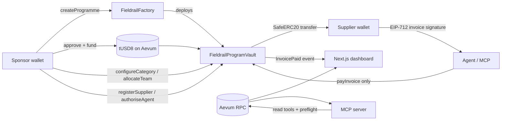

# Architecture

## System diagram

## Trust boundaries

| Boundary | Rule |
| --- | --- |
| Browser → RPC | Reads are untrusted until a receipt is confirmed. The UI never labels a transaction settled before `waitForTransactionReceipt` succeeds. |
| Sponsor → vault | Sponsor-only modifiers on all configuration, pause, close and refund functions. |
| Supplier → invoice | The supplier signature is the only proof of a quote; it is verified with OpenZeppelin-compatible `ECDSA.recover` against the registered supplier address. |
| Agent → vault | The agent can only call `payInvoice`. No generic transfer, admin or configuration path exists for the agent address. |
| Natural language → invoice draft | Deterministic parser only. Instruction-like text is treated as untrusted data; ambiguity stops for human review. The model cannot alter contract rules. |
| MCP server → chain | Read tools by default. The single write tool requires an explicit opt-in flag and a key that derives to the configured agent address; no sponsor key is ever present. |

## Contract responsibilities

- `FieldrailFactory.sol` — deploys vaults, prevents duplicate programme IDs, emits `ProgramCreated`, provides discovery. It owns no funds.
- `FieldrailProgramVault.sol` — holds tUSD8 and enforces every policy gate. State is updated before the token transfer; `ReentrancyGuard` and `SafeERC20` are used.
- `FieldrailTypes.sol` — canonical invoice struct and EIP-712 type hash. Field order is consensus-critical.

## Invoice digest

Domain: `EIP712Domain(string name,string version,uint256 chainId,address verifyingContract)` with `name = "FieldrailProgramVault"`, `version = "1"`, `chainId = 44005` and `verifyingContract = vault address`. This prevents replay across vaults and chains.

Signed struct binds: programme ID, invoice ID, team ID, category ID, supplier, token, amount, evidence hash, nonce and deadline.

## Data flow for a successful payment

1. Sponsor creates a vault through the factory and funds it with tUSD8 (balance delta measured).
2. Sponsor configures category caps, registers teams, allocates team/category caps, registers suppliers and authorises the agent mandate.
3. Supplier signs the invoice; the frontend uses `signTypedData` with the domain read from the contract.
4. Agent calls `payInvoice`. The contract checks 20+ conditions, consumes invoice ID and nonce, increments every spent counter, emits `InvoicePaid`, then transfers tUSD8.
5. UI reads the receipt and paginated logs and renders the explorer link.

## Design choices and trade-offs

- **Immutable identity fields** (`sponsor`, token, programme ID, time window) cannot be changed after deployment; this removes an entire class of hostile reconfiguration.
- **Safe reconfiguration rule** — once a category or allocation has spend, its cap can only increase, and never below the spent amount.
- **No upgradeable proxy** — simpler bytecode and no hidden upgrade key.
- **Local library shims** — upstream dependency fetch failed repeatedly on the build host; the minimal compatible shims are documented in `docs/TEST_RESULTS.md` and must be replaced with pinned upstream sources before any real-value deployment.
- **viem-only wallet layer** — the application uses viem with an injected EIP-1193 provider instead of wagmi. This keeps the dependency surface small and works with ordinary wallets; it is not QDay native ERC-4337.
